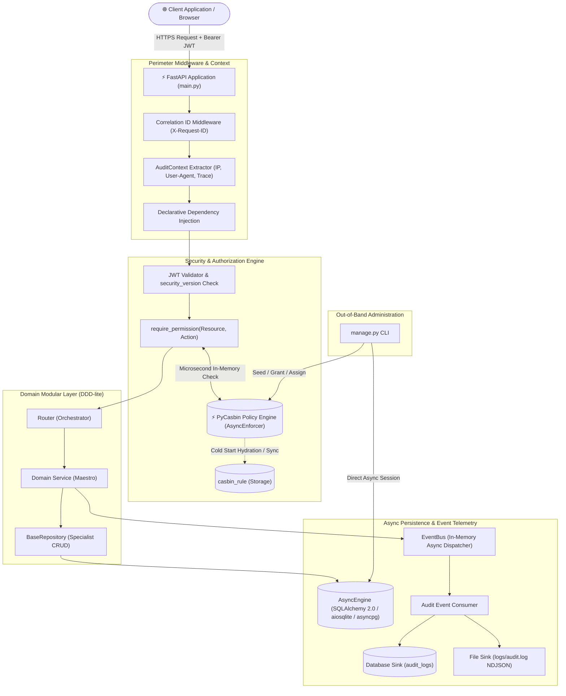

<div align="center">
  <h1>🚀 Enterprise FastAPI Base Foundation</h1>
  <p>
    <strong>Hardened, asynchronous backend foundation with PyCasbin RBAC, DDD-lite modularity, and zero-trust security.</strong>
  </p>

  <p>
    <a href="https://www.python.org/downloads/"></a>
    <a href="https://fastapi.tiangolo.com"></a>
    <a href="https://www.sqlalchemy.org/"></a>
    <a href="https://casbin.org/"></a>
    <a href="https://docs.astral.sh/uv/"></a>
    <a href="LICENSE"></a>
    
  </p>

  <p>
    <a href="#-system-architecture">Architecture</a> ·
    <a href="#-key-capabilities">Key Features</a> ·
    <a href="#-quickstart-guide">Quickstart</a> ·
    <a href="#-api-specification">API Spec</a> ·
    <a href="#-administrative-cli">Admin CLI</a> ·
    <a href="#-automated-testing">Testing</a>
  </p>

  <p>
    🌐 <strong><a href="README_AR.md">النسخة العربية (README_AR.md)</a></strong>
  </p>
</div>

---

## 🏛 System Architecture

The foundation employs a **Domain-Driven Design (DDD-lite)** modular monolith pattern combined with the **Orchestrator-Specialist** behavioral contract:



### Declarative API Security in Practice
Endpoints are protected with atomic, readable dependency factories without polluting business logic:

```python
@router.get(
    "",
    response_model=SuccessResponse[list[UserResponse]],
    dependencies=[Depends(require_permission(resource=Resource.USERS, action=Action.READ))],
)
async def list_users(
    session: AsyncSession = Depends(get_session),
    current_user: User = Depends(get_current_user),
) -> SuccessResponse[list[UserResponse]]:
    users = await UserService.get_all_users(session=session)
    return SuccessResponse(data=users)
```

---

## 💡 Overview & Why This Foundation?

Building production-ready backend services requires solving complex cross-cutting challenges before writing a single line of business logic: **authentication session invalidation**, **fine-grained role-based access control**, **observable structured audit logging**, **reliable database migrations**, and **safe administrative bootstrapping**.

This repository provides an enterprise-hardened blueprint designed to eliminate architectural debt:
* **Decoupled Authorization:** Moves beyond crude, hardcoded role checks (`if user.role == 'admin'`) into dynamic, resource-action authorization driven by **PyCasbin**.
* **Zero-Trust Token Revocation:** Prevents zombie sessions when passwords change via an atomic `security_version` counter embedded in JWT claims.
* **Separation of Concerns:** Strict adherence to the Orchestrator-Specialist pattern keeps HTTP routers lightweight, domain services cohesive, and database repositories generic and reusable.
* **Asynchronous First:** Built entirely on native `async`/`await` primitives across the network stack, database driver, and policy engine for high concurrency.

---

## ⚡ Key Capabilities

- 🛡️ **Zero-Trust Granular RBAC (PyCasbin):** Sub-millisecond policy evaluation evaluated in-memory with zero database round-trips per request. Supports role inheritance, wildcards (`*`), and user-specific policy overrides.
- 🔐 **Dual-Token Session Lifecycle & Auto-Revocation:** Issues short-lived access tokens (30 minutes) and revocable refresh tokens (30 days). Cryptographic JTI tracking in `refresh_sessions` with state-of-the-art Argon2id password hashing. Immediate global session invalidation on credential update via `security_version`.
- ⚡ **Native Asynchronous Persistence (SQLAlchemy 2.0):** Pure async I/O via `AsyncEngine` and `async_sessionmaker`. Generic `BaseRepository[Model]` provides standardized CRUD operations while supporting both SQLite (`aiosqlite`) and PostgreSQL (`asyncpg`).
- 📜 **Version-Controlled Database Evolution (Alembic):** Standardized constraint naming conventions (`ix_`, `uq_`, `ck_`, `fk_`, `pk_`) eliminate dialect inconsistencies. Zero runtime DDL generation in production with deterministic schema synchronization checks.
- 🕵️ **Multi-Sink Audit Logging & Telemetry:** Event-driven telemetry via in-memory `EventBus`. Simultaneously streams audit records to relational tables and high-speed disk logs in strict NDJSON format. Includes client IP extraction (`X-Forwarded-For`), User-Agent tracking, before/after state diffs, and strict credential redaction (`exclude={"password"}`).
- 📦 **Standardized API Contracts:** Unified Pydantic V2 response envelopes for single objects (`SuccessResponse`), paginated lists (`PaginatedResponse`), and structured error payloads with unique correlation trace IDs (`X-Request-ID`).
- 🧰 **Out-of-Band Administrative CLI (`manage.py`):** Standalone operations CLI to seed baseline permissions, create root administrators, and assign roles without exposing public registration endpoints.

---

## 🛠 Technology Stack

| Layer | Component | Version / Standard | Purpose |
| :--- | :--- | :--- | :--- |
| **Runtime & Toolchain** | [Python](https://www.python.org/) / [uv](https://docs.astral.sh/uv/) | `Python 3.13+` / `uv >= 0.5` | High-performance runtime and deterministic package management |
| **Web Framework** | [FastAPI](https://fastapi.tiangolo.com/) | `>= 0.141.1` | ASGI web routing, dependency injection, and OpenAPI contract generation |
| **Data & Serialization** | [Pydantic V2](https://docs.pydantic.dev/) | `>= 2.13.4` | Boundary schema validation, settings management (`pydantic-settings`) |
| **ORM & Database** | [SQLAlchemy 2.0](https://www.sqlalchemy.org/) | `>= 2.0.52 (Async)` | Async ORM, declarative mapping, and repository abstraction |
| **Database Drivers** | `aiosqlite` / `asyncpg` | `>= 0.22` / `>= 0.31` | High-throughput asynchronous drivers for SQLite and PostgreSQL |
| **Schema Migrations** | [Alembic](https://alembic.sqlalchemy.org/) | `>= 1.19.1` | Asynchronous migration pipeline with automated constraint naming |
| **Policy Engine** | [PyCasbin](https://casbin.org/) | `>= 1.43.0` | In-memory dynamic RBAC/ABAC authorization engine |
| **Cryptography** | [pwdlib[argon2]](https://github.com/frankie567/pwdlib) / [PyJWT](https://pyjwt.readthedocs.io/) | `>= 0.3.1` / `>= 2.13.0` | Argon2id password hashing and HS256 JWT encoding/decoding |
| **Testing** | [pytest](https://pytest.org/) / [httpx](https://www.python-httpx.org/) | `>= 9.1` / `>= 0.28` | Async integration test suite running 40 automated test scenarios |

---

## 🚀 Quickstart Guide

Get the server running locally in under two minutes:

### 1. Prerequisites
Ensure you have Python 3.13+ and [`uv`](https://docs.astral.sh/uv/) installed:
```bash
# Install uv (Windows PowerShell)
powershell -ExecutionPolicy ByPass -c "irm https://astral.sh/uv/install.ps1 | iex"

# Install uv (Linux / macOS)
curl -LsSf https://astral.sh/uv/install.sh | sh
```

### 2. Clone & Sync Dependencies
```bash
git clone <repository-url>
cd fastapi-base-structure-dev
uv sync
```

### 3. Configure Environment
Initialize the environment configuration file:
```bash
cp .env.example .env
```
*(The default `.env` is pre-configured for local SQLite development and works out of the box).*

### 4. Run Migrations & Seed Baseline Authorization
```bash
# Apply database schema
uv run alembic upgrade head

# Ingest default Casbin authorization policies
uv run python manage.py seed-policies
```

### 5. Launch Development Server
```bash
uv run uvicorn main:app --reload --host 127.0.0.1 --port 8000
```

### 6. Verify Health
```bash
curl http://127.0.0.1:8000/health
# Output: {"status":"healthy"}
```

---

## 📖 API Specification & Interactive Docs

Once running, interactive API documentation is automatically available at:
* **Swagger UI:** [http://127.0.0.1:8000/docs](http://127.0.0.1:8000/docs)
* **ReDoc:** [http://127.0.0.1:8000/redoc](http://127.0.0.1:8000/redoc)

### Core Endpoints Overview

| Method | Path | Permission Required | Description |
| :--- | :--- | :--- | :--- |
| `POST` | `/api/v1/auth/register` | *Public* | Register a new user account |
| `POST` | `/api/v1/auth/login` | *Public* | Authenticate and obtain Access & Refresh tokens |
| `POST` | `/api/v1/auth/refresh` | *Public (Refresh Token)* | Rotate refresh token and issue fresh access token |
| `POST` | `/api/v1/auth/change-password` | Authenticated | Change password & revoke all active sessions |
| `POST` | `/api/v1/auth/logout` | Authenticated | Revoke active refresh session |
| `GET` | `/api/v1/users/me` | Authenticated | Fetch current authenticated user profile |
| `GET` | `/api/v1/users` | `users:read` | List paginated users with deterministic sorting |
| `GET` | `/api/v1/users/{id}` | `users:read` | Retrieve specific user by ID |
| `GET` | `/api/v1/audit/logs` | `audit:read` | Query structured audit events with filters |
| `GET` | `/api/v1/audit/export` | `audit:export` | Export audit trail as `JSON`, `TXT`, or `MARKDOWN` |
| `GET` | `/health` | *Public* | Liveness and readiness health probe |

---

## 🧰 Administrative CLI (`manage.py`)

The repository includes a dedicated out-of-band CLI tool to manage policies and administrator credentials directly without exposing public HTTP endpoints.

> 📘 **Full Documentation:** See [manage.md](manage.md) for the complete English reference manual, or [manage_ar.md](manage_ar.md) for Arabic.

```bash
# Seed default authorization rules (admin, *, *) and (user, users, read)
uv run python manage.py seed-policies

# Create initial root administrator (prompts for password securely)
uv run python manage.py create-admin --email "admin@enterprise.io" --name "Root Admin"

# Promote an existing user to admin
uv run python manage.py promote-admin --email "user@enterprise.io"

# Grant permission to a role
uv run python manage.py grant auditor audit read
uv run python manage.py grant auditor audit export

# Bind a role to a user identifier
uv run python manage.py assign-role 5 auditor

# Inspect active permissions and role groupings
uv run python manage.py list-policies

# Revoke permission from a role (requires --force for admin * *)
uv run python manage.py revoke auditor audit export
```

---

## ⚙️ Configuration & Environment Variables

Settings are managed via `pydantic-settings` with automatic type casting, environment override, and production safety guards:

| Variable | Type | Default | Required | Description |
| :--- | :--- | :--- | :--- | :--- |
| `ENVIRONMENT` | `str` | `dev` | No | Runtime mode (`dev`, `test`, `staging`, `pro`). |
| `DATABASE_URL` | `str` | `sqlite+aiosqlite:///./database.db` | **Yes** | Async connection string (`sqlite+aiosqlite://...` or `postgresql+asyncpg://...`). |
| `ACCESS_SECRET_KEY` | `str` | *dev-placeholder* | **Yes** | Cryptographic secret for signing short-lived access tokens. |
| `REFRESH_SECRET_KEY` | `str` | *dev-placeholder* | **Yes** | Cryptographic secret for signing long-lived refresh tokens. |
| `ACCESS_TOKEN_EXPIRE_MINUTES` | `int` | `30` | No | Lifetime duration of access tokens in minutes. |
| `REFRESH_TOKEN_EXPIRE_DAYS` | `int` | `30` | No | Lifetime duration of refresh tokens in days. |
| `LOG_TO_DB` | `bool` | `true` | No | Enable or disable persisting audit events to the database. |
| `LOG_TO_FILE` | `bool` | `true` | No | Enable or disable appending structured NDJSON events to `logs/audit.log`. |
| `AUDIT_LOG_FILE_PATH` | `str` | `logs/audit.log` | No | Target filesystem location for file-based audit records. |
| `CORS_ORIGINS` | `list[str]` | `["http://localhost:3000", ...]` | No | Permitted CORS origins. Wildcard `*` is strictly blocked when `ENVIRONMENT=pro`. |

> [!CAUTION]
> When `ENVIRONMENT=pro`, the application validates that secret keys are not set to placeholder strings and that CORS origins do not contain wildcards (`*`). Failure triggers an immediate startup crash to prevent accidental insecure deployments.

---

## 📂 Project Structure

```
fastapi-base-structure/
├── main.py                     # Application factory, lifespan, global middleware & exception handlers
├── manage.py                   # Out-of-band administrative CLI (superusers, policy seeding, role bindings)
├── manage.md                   # Full CLI operation manual (English)
├── manage_ar.md                # Full CLI operation manual (Arabic)
├── pyproject.toml              # Project metadata, dependencies & tool configs (uv managed)
├── alembic.ini                 # Alembic migration engine configuration
├── .env.example                # Documented environment variable template
├── migrations/                 # Asynchronous database migration environment
│   ├── env.py                  # Migration runner with dynamic settings & metadata discovery
│   ├── script.py.mako          # Async revision template
│   ├── README.md               # Migration manual & database purge guide (English)
│   ├── README_AR.md            # Migration manual & database purge guide (Arabic)
│   └── versions/               # Deterministic, version-controlled migration files
├── src/
│   ├── database/               # Asynchronous persistence infrastructure
│   │   ├── base.py             # DeclarativeBase with standardized constraint naming conventions
│   │   ├── base_repo.py        # Generic BaseRepository[Model] (Async CRUD specialist)
│   │   ├── engine.py           # AsyncEngine & connection pool lifecycle manager
│   │   └── session.py          # Asynchronous database session dependency provider
│   ├── exc/                    # Domain exception hierarchy (AppException & standard error codes)
│   ├── modules/                # Self-contained domain modules (DDD-lite)
│   │   ├── auth/               # Authentication, token rotation, sessions & change-password
│   │   │   ├── dependencies.py # get_current_user & require_permission declarative factories
│   │   │   ├── model.py        # RefreshSession ORM entity with JTI tracking
│   │   │   ├── repo.py         # RefreshSessionRepository specialist
│   │   │   ├── router.py       # Authentication HTTP endpoints
│   │   │   ├── schemas.py      # Request/response validation contracts
│   │   │   └── service.py      # Auth business logic maestro
│   │   ├── user/               # User account domain
│   │   │   ├── model.py        # User ORM entity with security_version counter
│   │   │   ├── repo.py         # UserRepository specialist
│   │   │   ├── router.py       # User management endpoints
│   │   │   └── service.py      # User business logic maestro
│   │   └── audit/              # Security audit logging subsystem
│   │       ├── model.py        # AuditLog ORM entity with composite indexes
│   │       ├── repo.py         # AuditLogRepository specialist
│   │       ├── router.py       # Audit query and export endpoints
│   │       ├── formatters.py   # Multi-format export formatters (JSON, TXT, MARKDOWN)
│   │       └── service.py      # Multi-sink audit logger maestro (DB + NDJSON File)
│   ├── security/               # Cryptography & dynamic authorization engine
│   │   ├── authorization.py    # AuthorizationService facade wrapping PyCasbin AsyncEnforcer
│   │   └── security.py         # Password hashing (Argon2id) & JWT token encoders
│   ├── settings/               # Environment settings validation (Pydantic Settings)
│   └── share/                  # Shared primitives (Enums, Response Envelopes, EventBus)
│       ├── enum.py             # Roles, Resource, Action, Severity enums
│       ├── event_bus.py        # In-memory asynchronous domain event dispatcher
│       └── responses.py        # Standardized SuccessResponse, PaginatedResponse, ErrorResponse
└── tests/                      # Automated test suite (44 test scenarios)
    ├── conftest.py             # Isolated async SQLite fixtures & HTTP test clients
    ├── README.md               # Test documentation (English)
    └── README_AR.md            # Test documentation (Arabic)
```

---

## 🧪 Automated Testing

The project maintains **100% test pass rate** with 44 automated test scenarios covering the full API contract, security boundaries, and edge cases against an isolated in-memory SQLite database:

```bash
# Run all tests with verbose output
uv run pytest -v

# Run authorization and Casbin tests
uv run pytest tests/test_casbin_authorization.py -v

# Run password change and session invalidation tests
uv run pytest tests/test_password_change.py -v

# Run audit logging and telemetry tests
uv run pytest tests/test_audit_logging.py -v
```

> 📘 **Test Documentation:** See [tests/README.md](tests/README.md) and [tests/README_AR.md](tests/README_AR.md) for detailed test scenarios, contract envelopes, and architectural verification steps.

---

## 🛠 Developer Guide: Adding a New Domain Module

<details>
<summary><strong>Click to expand: 5-Step Guide to Adding a New Domain Module (e.g. Products)</strong></summary>

### Step 1: Create the Module Directory
```bash
mkdir src/modules/products
```

### Step 2: Define the ORM Entity (`src/modules/products/model.py`)
```python
from sqlalchemy import String
from sqlalchemy.orm import Mapped, mapped_column
from src.database.base import BaseModel
from src.database.mixin import DateTimeMixin

class Product(BaseModel, DateTimeMixin):
    __tablename__ = "products"

    id: Mapped[int] = mapped_column(primary_key=True, autoincrement=True)
    title: Mapped[str] = mapped_column(String(200), nullable=False)
```

### Step 3: Create the Repository Specialist (`src/modules/products/repo.py`)
```python
from sqlalchemy.ext.asyncio import AsyncSession
from src.database.base_repo import BaseRepository
from .model import Product

class ProductRepository(BaseRepository[Product]):
    def __init__(self, session: AsyncSession):
        super().__init__(model=Product, session=session)
```

### Step 4: Implement Service Maestro & Router
* Implement business logic in `service.py`.
* Implement HTTP endpoints in `router.py` protected by `require_permission(Resource.PRODUCTS, Action.READ)`.

### Step 5: Register Router and Generate Migration
* Mount the router in `src/modules/__init__.py`.
* Import the `Product` entity in `migrations/env.py`.
* Generate and apply the migration:
  ```bash
  uv run alembic revision --autogenerate -m "add_products_table"
  uv run alembic upgrade head
  ```
</details>

---

## 📄 License & Contributing

This project is open-source and released under the [MIT License](LICENSE). Contributions, bug reports, and pull requests adhering to the repository's architectural principles are welcome.
