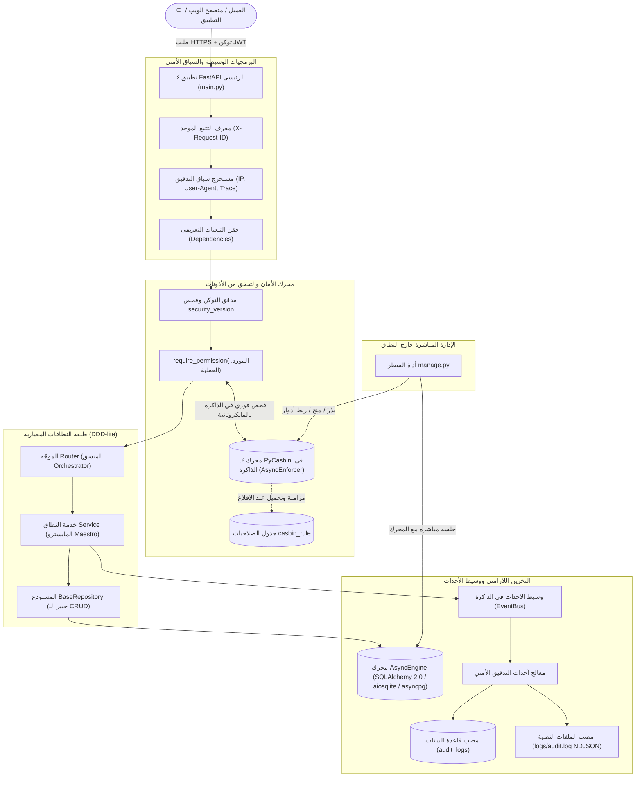

<div align="center">
  <h1>🚀 البنية التحتية القياسية لتطبيقات FastAPI للمؤسسات</h1>
  <p>
    <strong>قاعدة مشاريع خلفية فائقة الأداء، مؤمنة بالكامل بمحرك PyCasbin، ومعمارية موجهة بالنطاق (DDD-lite) ومبادئ انعدام الثقة (Zero-Trust).</strong>
  </p>

  <p>
    <a href="https://www.python.org/downloads/"></a>
    <a href="https://fastapi.tiangolo.com"></a>
    <a href="https://www.sqlalchemy.org/"></a>
    <a href="https://casbin.org/"></a>
    <a href="https://docs.astral.sh/uv/"></a>
    <a href="LICENSE"></a>
    
  </p>

  <p>
    <a href="#-المخطط-المعماري-للنظام">المعمارية</a> ·
    <a href="#-الميزات-والقدرات-الرئيسية">الميزات الرئيسية</a> ·
    <a href="#-دليل-البدء-السريع">البدء السريع</a> ·
    <a href="#-مواصفات-واجهة-الـ-api">الـ API</a> ·
    <a href="#-أداة-الإدارة-والتحكم-managepy">أداة الإدارة</a> ·
    <a href="#-منظومة-الاختبارات-المؤتمتة">الاختبارات</a>
  </p>

  <p>
    🌐 <strong><a href="README.md">English Documentation (README.md)</a></strong>
  </p>
</div>

---

## 🏛 المخطط المعماري للنظام

يعتمد المشروع على نمط المعمارية المعيارية الموجهة بالنطاق (**DDD-lite**) مدمجاً مع عقد السلوك البرمجي للمنسق والمتخصص (**Orchestrator-Specialist Pattern**):



### الأمان التعريفي المباشر في الكود
تتم حماية نقاط النهاية عبر دوال حقن تبعيات نقية ومقروءة دون تلويث منطق الأعمال بأكواد الأمان:

```python
@router.get(
    "",
    response_model=SuccessResponse[list[UserResponse]],
    dependencies=[Depends(require_permission(resource=Resource.USERS, action=Action.READ))],
)
async def list_users(
    session: AsyncSession = Depends(get_session),
    current_user: User = Depends(get_current_user),
) -> SuccessResponse[list[UserResponse]]:
    users = await UserService.get_all_users(session=session)
    return SuccessResponse(data=users)
```

---

## 💡 لماذا هذه البنية التحتية؟

بناء خدمات خلفية جاهزة للإنتاج المؤسسي يتطلب حل تحديات بنيوية معقدة قبل كتابة سطر واحد من منطق العمل: **إبطال الجلسات النشطة عند تغيير كلمات المرور**، **الفصل التام للصلاحيات عن الأدوار الثابتة**، **تسجيل سجلات التدقيق الأمني بأداء عالٍ دون تسريب البيانات الحساسة**، **إدارة هجرات قواعد البيانات بشكل تزامني دقيق**، و**التهيئة الأولى للمسؤولين خارج النطاق**.

يوفر هذا المستودع نموذجاً مؤسسياً مصمماً للقضاء على الديون المعمارية:
* **فصل الصلاحيات الديناميكي:** الانتقال من فحص الأدوار البدائي المكتوب يدوياً في الكود (`if user.role == 'admin'`) إلى نظام أذونات ديناميكي دقيق يعتمد على الموارد والعمليات عبر **PyCasbin**.
* **مبدأ انعدام الثقة وإبطال التوكنات الفوري:** منع الجلسات المخترقة من العمل عند تغيير بيانات الاعتماد بفضل عداد `security_version` الذري المرتبط ببيانات الـ JWT.
* **فصل المسؤوليات بدقة:** التزام صارم بنمط المنسق والخبير (Orchestrator-Specialist)؛ فالراوترات خفيفة، وخدمات النطاق متماسكة، ومستودعات البيانات عامة وقابلة لإعادة الاستخدام.
* **الاعتماد الكلي على المعالجة غير المتزامنة (Async First):** بناء النظام بالكامل على أحدث أدوات `async`/`await` عبر شبكة الاتصال، محرك قاعدة البيانات، ومحرك فحص الصلاحيات لضمان أقصى كفاءة للموارد.

---

## ⚡ الميزات والقدرات الرئيسية

- 🛡️ **نظام أذونات دقيق ومبني على انعدام الثقة (PyCasbin):** تقييم لحظي للصلاحيات في الذاكرة دون استهلاك استعلامات لقاعدة البيانات أثناء معالجة الطلب. يدعم توريث الأدوار، الصلاحيات الشاملة (`*`)، والتخصيص المباشر للمستخدمين الفرديين.
- 🔐 **دورة حياة ثنائية للتوكنات وإبطال فوري للجلسات:** إصدار توكن وصول قصير الأجل (30 دقيقة) وتوكن تحديث قابل للإلغاء (30 يوماً). تتبع التوكنات عبر معرّف مشفر فريد (`jti`) في جدول `refresh_sessions`، مع تشفير حديث لكلمات المرور عبر Argon2id. إبطال شامل وفوري لكافة الجلسات بمجرد تغيير كلمة المرور عبر `security_version`.
- ⚡ **تخزين غير متزامن أصيل (SQLAlchemy 2.0 Async):** عمليات إدخال وإخراج لازامنة عبر `AsyncEngine` ومجمع اتصالات `async_sessionmaker`. يوفر `BaseRepository[Model]` عمليات CRUD قياسية مع دعم كامل ومزدوج لـ SQLite (`aiosqlite`) و PostgreSQL (`asyncpg`).
- 📜 **إدارة المخطط عبر الهجرات الإصدارية فقط (Alembic):** اعتماد معايير تسمية صارمة وموحدة للقيود (`ix_`, `uq_`, `ck_`, `fk_`, `pk_`) لمنع أخطاء التوليد التلقائي. منع إنشاء الجداول برمجياً في الإنتاج وحصرها في ملفات هجرات قابلة للمراجعة والفحص الآلي.
- 🕵️ **تدقيق أمني متعدد المصاب ووسيط أحداث (EventBus):** تتبع أمني مفصول عبر وسيط أحداث داخلي في الذاكرة. بث لحظي لسجلات التدقيق نحو قاعدة البيانات وملفات الأقراص بتنسيق NDJSON القياسي. يتضمن تتبع عنوان العميل الحقيقي (`X-Forwarded-For`)، نوع المتصفح، الفروقات قبل وبعد التعديل (`diffs`)، وحجب قاطع لكلمات المرور والبيانات الحساسة.
- 📦 **قوالب استجابة موحدة (Unified Pydantic Envelopes):** توحيد أغلفة الردود للكائنات الفردية (`SuccessResponse`)، القوائم المجزأة (`PaginatedResponse`)، وأغلفة الأخطاء الموحدة المحقونة بمعرّف التتبع الفريد (`X-Request-ID`).
- 🧰 **أداة إدارة وتحكم خارج النطاق (`manage.py` CLI):** أداة سطر أوامر معزولة لتهيئة الصلاحيات الافتراضية، إنشاء المشرفين، وترقية وتعيين الأدوار دون الحاجة لفتح واجهات API عامة خطيرة.

---

## 🛠 حزمة التقنيات المستخدمة

| الطبقة التقنية | المكون | الإصدار / المعيار | الهدف المعماري |
| :--- | :--- | :--- | :--- |
| **البيئة ومدير الحزم** | [Python](https://www.python.org/) / [uv](https://docs.astral.sh/uv/) | `Python 3.13+` / `uv >= 0.5` | بيئة تشغيل حديثة وإدارة فائقة السرعة للحزم والبيئات الافتراضية |
| **إطار عمل الويب** | [FastAPI](https://fastapi.tiangolo.com/) | `>= 0.141.1` | توجيه الـ ASGI، حقن التبعيات، وتوليد وثائق OpenAPI تلقائياً |
| **البيانات والتحقق** | [Pydantic V2](https://docs.pydantic.dev/) | `>= 2.13.4` | التحقق الصارم من صحة البيانات، وإدارة الإعدادات (`pydantic-settings`) |
| **طبقة الـ ORM** | [SQLAlchemy 2.0](https://www.sqlalchemy.org/) | `>= 2.0.52 (Async)` | تخطيط العلاقات الكائني غير المتزامن وتجريد المستودعات |
| **مشغلات قواعد البيانات** | `aiosqlite` / `asyncpg` | `>= 0.22` / `>= 0.31` | محركات الاتصال غير المتزامنة لـ SQLite محلياً و PostgreSQL إنتاجياً |
| **هجرات المخطط** | [Alembic](https://alembic.sqlalchemy.org/) | `>= 1.19.1` | تتبع تطور قاعدة البيانات وضبط القيود تلقائياً |
| **محرك الصلاحيات** | [PyCasbin](https://casbin.org/) | `>= 1.43.0` | محرك أذونات ديناميكي في الذاكرة مبني على معايير RBAC/ABAC |
| **التشفير والأمان** | [pwdlib[argon2]](https://github.com/frankie567/pwdlib) / [PyJWT](https://pyjwt.readthedocs.io/) | `>= 0.3.1` / `>= 2.13.0` | تشفير وتدقيق كلمات المرور بـ Argon2id وترميز توكنات الـ JWT |
| **منظومة الاختبار** | [pytest](https://pytest.org/) / [httpx](https://www.python-httpx.org/) | `>= 9.1` / `>= 0.28` | 40 اختبار مؤتمت يغطي كافة المسارات والحالات الحدية بنجاح 100% |

---

## 🚀 دليل البدء السريع

شغّل الخادم محلياً في بيئة عملك في أقل من دقيقتين:

### 1. المتطلبات المسبقة
تأكد من تثبيت Python 3.13+ ومدير الحزم [`uv`](https://docs.astral.sh/uv/):
```bash
# تثبيت uv على أنظمة Windows (PowerShell)
powershell -ExecutionPolicy ByPass -c "irm https://astral.sh/uv/install.ps1 | iex"

# تثبيت uv على أنظمة Linux / macOS
curl -LsSf https://astral.sh/uv/install.sh | sh
```

### 2. استنساخ المستودع وتثبيت الاعتماديات
```bash
git clone <repository-url>
cd fastapi-base-structure-dev
uv sync
```

### 3. إعداد متغيرات البيئة
أنشئ ملف البيئة المحلي من النموذج المشروح:
```bash
cp .env.example .env
```
*(الملف الافتراضي مهيأ تلقائياً للعمل الفوري مع قاعدة بيانات SQLite المحلية دون أي تعديل).*

### 4. تطبيق الهجرات وبذر الصلاحيات الأساسية
```bash
# إنشاء وتحديث جداول قاعدة البيانات
uv run alembic upgrade head

# بذر سياسات الصلاحيات الافتراضية لمحرك Casbin
uv run python manage.py seed-policies
```

### 5. إطلاق خادم التطوير
```bash
uv run uvicorn main:app --reload --host 127.0.0.1 --port 8000
```

### 6. التحقق من سلامة النظام
```bash
curl http://127.0.0.1:8000/health
# المخرجات المتوقعة: {"status":"healthy"}
```

---

## 📖 مواصفات واجهة الـ API

بمجرد إقلاع الخادم، تتوفر وثائق تفاعلية متكاملة عبر المتصفح:
* **واجهة Swagger UI:** [http://127.0.0.1:8000/docs](http://127.0.0.1:8000/docs)
* **واجهة ReDoc:** [http://127.0.0.1:8000/redoc](http://127.0.0.1:8000/redoc)

### نظرة عامة على نقاط النهاية الأساسية

| الطريقة | المسار | الصلاحية المطلوبة | الوصف والوظيفة |
| :--- | :--- | :--- | :--- |
| `POST` | `/api/v1/auth/register` | *عام (متاح للجميع)* | إنشاء حساب مستخدم عادي جديد |
| `POST` | `/api/v1/auth/login` | *عام (متاح للجميع)* | المصادقة وإصدار توكن الوصول وتوكن التحديث |
| `POST` | `/api/v1/auth/refresh` | *عام (عبر توكن التحديث)* | تدوير توكن التحديث وإصدار توكن وصول جديد |
| `POST` | `/api/v1/auth/change-password` | مستخدم مصادق | تغيير كلمة المرور وإبطال كافة الجلسات النشطة فوراً |
| `POST` | `/api/v1/auth/logout` | مستخدم مصادق | إلغاء وإبطال جلسة التحديث الحالية |
| `GET` | `/api/v1/users/me` | مستخدم مصادق | استعراض بيانات الحساب الشخصي للمستخدم الحالي |
| `GET` | `/api/v1/users` | `users:read` | جلب قائمة المستخدمين مع الترقيم والفرز المحدد |
| `GET` | `/api/v1/users/{id}` | `users:read` | جلب بيانات مستخدم محدد بالمعرف |
| `GET` | `/api/v1/audit/logs` | `audit:read` | الاستعلام عن سجلات التدقيق الأمني مع الفلترة |
| `GET` | `/api/v1/audit/export` | `audit:export` | تصدير سجلات التدقيق بصيغة `JSON` أو `TXT` أو `MARKDOWN` |
| `GET` | `/health` | *عام (متاح للجميع)* | فحص الحيوية وجاهزية الخادم للعمل |

---

## 🧰 أداة الإدارة والتحكم (`manage.py`)

يتضمن المشروع أداة إدارة معزولة للتحكم في الصلاحيات وإنشاء الحسابات الإدارية مباشرة دون فتح واجهات ويب خطيرة.

> 📘 **التوثيق الكامل:** راجع [manage_ar.md](manage_ar.md) للاطلاع على الدليل المرجعي الشامل بالعربية، أو [manage.md](manage.md) للنسخة الإنجليزية.

```bash
# بذر القواعد التأسيسية (admin, *, *) و (user, users, read)
uv run python manage.py seed-policies

# إنشاء حساب مسؤول أول من الصفر (إدخال مخفي لكلمة المرور)
uv run python manage.py create-admin --email "admin@enterprise.io" --name "Root Admin"

# ترقية مستخدم مسجل مسبقاً إلى مسؤول
uv run python manage.py promote-admin --email "user@enterprise.io"

# منح صلاحية لدور معين على مورد وعملية
uv run python manage.py grant auditor audit read
uv run python manage.py grant auditor audit export

# ربط دور بمستخدم محدد بالمعرف الرقمي
uv run python manage.py assign-role 5 auditor

# استعراض كافة السياسات وتعيينات الأدوار النشطة
uv run python manage.py list-policies

# سحب صلاحية من دور (يتطلب --force لسحب صلاحية admin * *)
uv run python manage.py revoke auditor audit export
```

---

## ⚙️ مصفوفة الإعدادات ومتغيرات البيئة

تُدار الإعدادات عبر `pydantic-settings` مع التحقق التلقائي من الأنواع، وقبول المتغيرات البيئية، وصمامات أمان حتمية للإنتاج:

| المتغير | النوع | القيمة الافتراضية | إلزامي؟ | الوصف والغرض المعماري |
| :--- | :--- | :--- | :--- | :--- |
| `ENVIRONMENT` | `str` | `dev` | لا | نمط البيئة التشغيلية (`dev`, `test`, `staging`, `pro`). |
| `DATABASE_URL` | `str` | `sqlite+aiosqlite:///./database.db` | **نعم** | عنوان الاتصال غير المتزامن بقاعدة البيانات (`sqlite` أو `postgresql`). |
| `ACCESS_SECRET_KEY` | `str` | *نص افتراضي للتطوير* | **نعم** | المفتاح السري المشفر لتوقيع توكنات الوصول القصيرة. |
| `REFRESH_SECRET_KEY` | `str` | *نص افتراضي للتطوير* | **نعم** | المفتاح السري المشفر لتوقيع توكنات التحديث طويلة الأجل. |
| `ACCESS_TOKEN_EXPIRE_MINUTES` | `int` | `30` | لا | العمر الزمني لتوكن الوصول بالدقائق. |
| `REFRESH_TOKEN_EXPIRE_DAYS` | `int` | `30` | لا | العمر الزمني لتوكن التحديث بالأيام. |
| `LOG_TO_DB` | `bool` | `true` | لا | تفعيل أو تعطيل حفظ سجلات التدقيق في قاعدة البيانات. |
| `LOG_TO_FILE` | `bool` | `true` | لا | تفعيل أو تعطيل كتابة سجلات التدقيق النصية إلى القرص بصيغة NDJSON. |
| `AUDIT_LOG_FILE_PATH` | `str` | `logs/audit.log` | لا | مسار ملف حفظ سجلات التدقيق على نظام التشغيل. |
| `CORS_ORIGINS` | `list[str]` | `["http://localhost:3000", ...]` | لا | نطاقات الـ CORS المصرح لها بالتواصل مع الخادم. النجمة `*` محظورة في الإنتاج. |

> [!CAUTION]
> عند ضبط `ENVIRONMENT=pro`، يرفض التطبيق الإقلاع فوراً إذا كانت المفاتيح السرية نصوصاً تجريبية أو إذا احتوت نطاقات CORS على الرمز الشامل `*`، وذلك لحماية البيئة الإنتاجية من الإعدادات الخاطئة.

---

## 📂 هيكل المشروع والمجلدات

```text
fastapi-base-structure/
├── main.py                     # نقطة دخول التطبيق، دورة الحياة (Lifespan)، البرمجيات الوسيطة ومعالجات الأخطاء
├── manage.py                   # أداة السطر المعمارية للإدارة، بذر الصلاحيات، وإنشاء المشرفين
├── manage.md                   # الدليل المرجعي الشامل لأداة الإدارة (English)
├── manage_ar.md                # الدليل المرجعي الشامل لأداة الإدارة (العربية)
├── pyproject.toml              # بيانات المشروع والاعتماديات (مُدار عبر uv)
├── alembic.ini                 # إعدادات هجرات قاعدة البيانات Alembic
├── .env.example                # نموذج متغيرات البيئة المشروح
├── migrations/                 # بيئة هجرات قاعدة البيانات غير المتزامنة
│   ├── env.py                  # ملف تشغيل الهجرات المربوط بالإعدادات والنماذج
│   ├── script.py.mako          # قالب التوليد التلقائي لملفات الهجرة
│   ├── README.md               # دليل الهجرات وتصفير القاعدة (English)
│   ├── README_AR.md            # دليل الهجرات وتصفير القاعدة (العربية)
│   └── versions/               # ملفات الهجرات المؤرخة والمفهرسة
├── src/
│   ├── database/               # بنية قاعدة البيانات التحتية
│   │   ├── base.py             # DeclarativeBase مع معايير التسمية القياسية للقيود
│   │   ├── base_repo.py        # المستودع العام BaseRepository[Model] (خبير الـ CRUD)
│   │   ├── engine.py           # محرك AsyncEngine وإدارة دورة حياة مجمع الاتصال
│   │   └── session.py          # مزود حقن جلسات قاعدة البيانات غير المتزامنة
│   ├── exc/                    # التسلسل الهرمي للاستثناءات (AppException ورموز الأخطاء القياسية)
│   ├── modules/                # موديولات النطاق المستقلة ذاتياً (DDD-lite)
│   │   ├── auth/               # المصادقة، تدوير التوكنات، الجلسات، وتغيير كلمة المرور
│   │   │   ├── dependencies.py # مصانع التبعيات: get_current_user و require_permission
│   │   │   ├── model.py        # نموذج RefreshSession وتتبع الـ JTI
│   │   │   ├── repo.py         # مستودع جلسات التحديث المتخصص
│   │   │   ├── router.py       # مسارات الـ HTTP للمصادقة
│   │   │   ├── schemas.py      # عقود التحقق من المدخلات والمخرجات
│   │   │   └── service.py      # خدمة المصادقة (المايسترو)
│   │   ├── user/               # إدارة المستخدمين والحسابات
│   │   │   ├── model.py        # نموذج المستخدم وتتبع security_version
│   │   │   ├── repo.py         # مستودع المستخدمين المتخصص
│   │   │   ├── router.py       # مسارات إدارة المستخدمين
│   │   │   └── service.py      # خدمة إدارة المستخدمين (المايسترو)
│   │   └── audit/              # نظام التدقيق الأمني الشامل
│   │       ├── model.py        # نموذج AuditLog وفهارسه المركبة
│   │       ├── repo.py         # مستودع سجلات التدقيق المتخصص
│   │       ├── router.py       # مسارات الاستعلام عن وتصدير السجلات
│   │       ├── formatters.py   # منسقات التصدير (JSON, TXT, MARKDOWN)
│   │       └── service.py      # خدمة التدقيق الأمني متعددة المصاب (قاعدة بيانات + ملف نصي)
│   ├── security/               # محرك الأمان والتشفير والأذونات
│   │   ├── authorization.py    # واجهة خدمة AuthorizationService الحاضنة لمحرك PyCasbin
│   │   └── security.py         # تشفير كلمات المرور (Argon2id) وترميز JWT
│   ├── settings/               # إدارة متغيرات البيئة عبر Pydantic Settings
│   └── share/                  # العناصر المشتركة (Enums, Response Envelopes, EventBus)
│       ├── enum.py             # تعدادات الأدوار، الموارد، والعمليات
│       ├── event_bus.py        # وسيط أحداث النطاق غير المتزامن في الذاكرة
│       └── responses.py        # أغلفة الاستجابة القياسية (SuccessResponse, PaginatedResponse, ErrorResponse)
└── tests/                      # منظومة الاختبارات المؤتمتة (40 سيناريو فحص)
    ├── conftest.py             # إعدادات وعملاء الاختبار غير المتزامنة مع SQLite في الذاكرة
    ├── README.md               # توثيق الاختبارات (English)
    └── README_AR.md            # توثيق الاختبارات (العربية)
```

---

## 🧪 منظومة الاختبارات المؤتمتة

يحافظ المشروع على **نسبة نجاح 100%** عبر 40 سيناريو فحص آلي تغطي كافة عقود الـ API، صمامات الأمان، والحالات الحدية بالاعتماد على قاعدة بيانات SQLite معزولة في الذاكرة:

```bash
# تشغيل كافة الاختبارات مع التفاصيل
uv run pytest -v

# تشغيل اختبارات نظام الصلاحيات ومحرك Casbin
uv run pytest tests/test_phase2_authorization.py -v

# تشغيل اختبارات تغيير كلمة المرور وإبطال الجلسات
uv run pytest tests/test_phase1_security_hardening.py -v

# تشغيل اختبارات التدقيق الأمني والمصاب المزدوجة
uv run pytest tests/test_audit_logging.py -v
```

> 📘 **توثيق الاختبارات:** راجع [tests/README_AR.md](tests/README_AR.md) أو [tests/README.md](tests/README.md) للاطلاع على تفاصيل عقود الاستجابة وسيناريوهات الفحص المعتمدة.

---

## 🛠 دليل المطور: كيفية إضافة نطاق جديد للمشروع

<details>
<summary><strong>اضغط هنا لفتح الدليل: 5 خطوات لإضافة نطاق جديد بالكامل (مثال: المنتجات Products)</strong></summary>

### الخطوة 1: إنشاء مجلد النطاق الجديد
```bash
mkdir src/modules/products
```

### الخطوة 2: تعريف نموذج قاعدة البيانات (`src/modules/products/model.py`)
```python
from sqlalchemy import String
from sqlalchemy.orm import Mapped, mapped_column
from src.database.base import BaseModel
from src.database.mixin import DateTimeMixin

class Product(BaseModel, DateTimeMixin):
    __tablename__ = "products"

    id: Mapped[int] = mapped_column(primary_key=True, autoincrement=True)
    title: Mapped[str] = mapped_column(String(200), nullable=False)
```

### الخطوة 3: إنشاء المستودع المتخصص (`src/modules/products/repo.py`)
```python
from sqlalchemy.ext.asyncio import AsyncSession
from src.database.base_repo import BaseRepository
from .model import Product

class ProductRepository(BaseRepository[Product]):
    def __init__(self, session: AsyncSession):
        super().__init__(model=Product, session=session)
```

### الخطوة 4: كتابة الخدمة والراوتر
* بناء منطق الأعمال في `service.py`.
* بناء مسارات الـ HTTP في `router.py` وتأمينها برمجياً عبر `require_permission(Resource.PRODUCTS, Action.READ)`.

### الخطوة 5: تسجيل الراوتر وتوليد الهجرة
* استيراد الراوتر في `src/modules/__init__.py`.
* استيراد نموذج `Product` في `migrations/env.py`.
* توليد وتطبيق الهجرة:
  ```bash
  uv run alembic revision --autogenerate -m "add_products_table"
  uv run alembic upgrade head
  ```
</details>

---

## 📄 الترخيص والمساهمة

هذا المشروع مفتوح المصدر وموزع تحت مظلة رخصة **[MIT License](LICENSE)**. نرحب بكافة المساهمات والمقترحات البرمجية التي تلتزم بدستور المعمارية البرمجية للمشروع.
